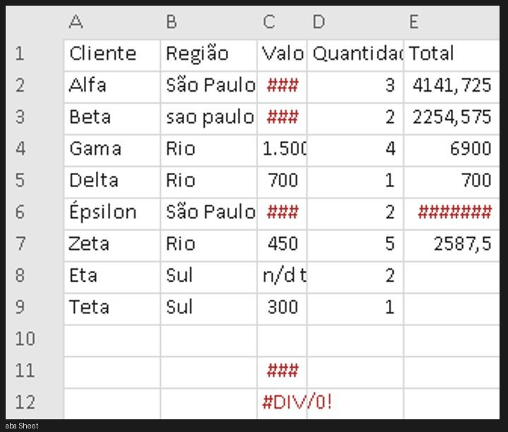
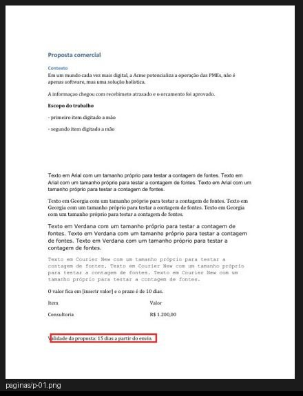
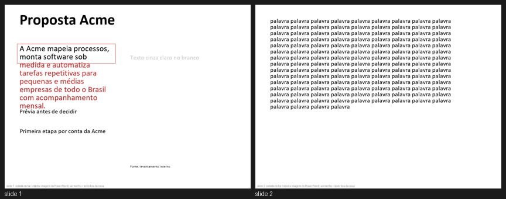

<h1 align="center">toc</h1>

<p align="center">
  <b>TOC</b> · Transtorno Obsessivo-Compulsivo &nbsp;|&nbsp; <b>OCD</b> · Obsessive-Compulsive Disorder<br>
  <sub>…for your AI agent.</sub>
</p>

<p align="center">
  <a href="LICENSE"></a>
  &nbsp;
  &nbsp;
  &nbsp;<a href="README.pt-BR.md"></a>
</p>

<p align="center"><b>Your agent says "Done ✅". toc says: "the proposal still says <code>[insert value]</code>."</b></p>

---

You know the feeling. You lock the door, walk to the car, and something pulls you back: *did I really lock it?* You check. Then you check again.

**toc gives Claude that itch, aimed at your deliverable.** It can't stop working while the spreadsheet total shows `#DIV/0!`, the mobile pause button sits on top of the CTA, or the PDF still says "generated by python-docx". Unlike the real thing, this one has an off switch and a round limit.

> The name is a nod to the checking-and-rechecking habit, not a joke about the people who live with OCD.

## Install

```bash
git clone https://github.com/luccameyer18-creator/claude-skill-toc && node claude-skill-toc/install.mjs
```

It copies the skill to `~/.claude/skills/toc`, adds the Stop hook to `~/.claude/settings.json` (with a backup), and tells you what's missing. Open a new Claude Code session and ask:

```
modo toc: write the proposal for Acme in Word, 2 pages, sections Context, Scope, Pricing
```

or just *"don't stop until it's perfect"*.

## Without toc vs with toc

| Without toc | With toc |
|---|---|
| "Done! I created the proposal, the spreadsheet and the landing page ✅" | `toc, round 1/8. Found issues:`<br>`[contract C1] sections Context, Scope, Pricing: missing Pricing`<br>`[blocks] "The price is [insert value]"`<br>`[blocks] Sheet!C12 shows #DIV/0!`<br>`[fix] =SUM(C2:C8) stops at row 8, data goes to row 9`<br>`[fix] pause button covers "See how it works" at 390px`<br>`[fix] "informaçao" → informação` |
| You find the mistakes when the client does. | Claude finds them, fixes them, and an independent reviewer double-checks before it's allowed to stop. |

<table>
  <tr>
    <td width="50%"><br><sub>Spreadsheet: <code>####</code>, <code>#DIV/0!</code>, "São Paulo" and "sao paulo " in the same column.</sub></td>
    <td width="50%"><br><sub>Diff between rounds: the red box is the only thing that changed. Catches "fixed A, broke B".</sub></td>
  </tr>
  <tr>
    <td colspan="2"><br><sub>Slides: text that won't fit its box (in red), 1.67:1 gray on white, a 130-word slide with no title.</sub></td>
  </tr>
</table>

## Why

AI ships work that looks finished and isn't. The mistakes are small, and they're the ones people screenshot:

- `[insert value]` left in a proposal whose own table says R$ 1,200
- a total of `=SUM(C2:C8)` when the data goes to row 9
- a spreadsheet "generated by script" whose formulas have no saved values, so the email preview shows blank cells
- `author: python-docx` in the file properties, Letter paper on a Brazilian document
- light gray text at 1.67:1 on a slide, 9pt footnotes on a projector
- "It's not just software, it's a holistic solution" (and four more em dashes)
- fixing the hero and quietly breaking the footer

Every one of these was caught in toc's own tests.

## How it works

1. **Contract.** Claude turns your request into `.claude/toc/contrato.json`: what you asked for, and what it must not touch. Nothing you didn't ask for becomes a requirement.
2. **Inspection.** Scripts look at the real thing: a headless browser scrolls the page on desktop, tablet and phone (with reduced motion too); Word and Excel render and recalculate copies of your files; text gets checked for typos and AI tells.
3. **Fresh eyes.** A reviewer subagent that never saw the work being done reads the photos and the text and writes a verdict. It gets a typography sheet with the fonts the browser or Word actually used, so it doesn't guess fonts from a screenshot.
   After that, re-checks are cheap: the hook crops a "before | after" of each open issue, plus anything that changed outside those spots, and a small model (Haiku) just ticks them off. Nothing gets re-reviewed from scratch unless it has to be.
4. **The itch.** A Stop hook won't let Claude finish while anything in the contract, the scripts or the verdict is still open. Each round is diffed against the last one, so a fix that breaks something else shows up in red.
5. **No grading your own homework.** When the loop starts, toc locks what does the checking: test files (`*.test.*`, `*.spec.*`, `tests/`, `test_*.py`…), every contract item, the minimum score and the build command. If Claude edits a test to make it pass, deletes a requirement or lowers the bar, the hook blocks and says `toc restaurar` puts the originals back. Changing them takes your yes (`toc liberar <file> --motivo "..."`), and every release shows up to you when the loop ends.
6. **The off switch.** 8 rounds by default, then an honest report of what's still open. Never "it's perfect".
7. **It never hijacks your chat.** The loop belongs to the request that started it. Send a new message and it pauses on its own (Claude resumes it only if you're still on the same deliverable). Six idle hours and it switches off.

**Two versions, not one squeezed.** For web pages toc checks desktop and phone as separate designs: a phone layout with no `@media` rule that changes the layout, text columns squeezed under 150px, body text under 14px, a headline the same size on both. And the reviewer always judges whether each screen has its own composition.

## What it checks

<details>
<summary><b>Web pages</b></summary>

Contrast measured on the screenshot (works over video and WebGL), clipped text, text off screen, text on top of text, a fixed button covering another, near-misses in alignment (2 to 4px), a lone word or a dangling "a" in a heading, tap targets, invisible focus, stretched or broken images, fonts that didn't load, console and network errors, layout shift.

Tells and polish, inspired by [Impeccable](https://github.com/pbakaus/impeccable) and [Taste Skill](https://github.com/Leonxlnx/taste-skill): gray text on color, flat type hierarchy, too many font sizes, everything centered, eyebrow labels and 01/02 above headings, bouncy easing, colored side stripes, gradient text, unthemed text selection. Plus a squint test: where does the eye land first?
</details>

<details>
<summary><b>Word, PowerPoint, Excel, CSV, PDF, Markdown</b></summary>

- **docx:** skipped heading levels, fake headings (bold Normal text), hand-typed bullets, empty lines as spacing, too many fonts, leftover tracked changes and comments, Letter paper, wrong proofing language. With Word: blank pages, a heading stranded at the bottom of a page, "Error! Reference source not found".
- **pptx:** text that won't fit its box (measured with the real font), overlapping text, off-slide objects, titles jumping between slides, fonts under 12pt, walls of text, contrast, stretched images. PowerPoint is never opened; the reviewer gets a sketch.
- **xlsx:** formula errors (recalculated in Excel), formulas with no saved value, broken references, numbers stored as text, sums that skip rows, a formula that breaks its column's pattern, hard-coded constants, `####` columns, categories spelled two ways.
- **csv / pdf / md:** encoding, ragged rows, blank pages, broken links, unclosed code blocks.
</details>

<details>
<summary><b>Text, everywhere</b></summary>

Silly mistakes (leftover placeholders, doubled words, glued commas, mixed number and date formats, a name spelled two ways), spelling via Word's own dictionary, and AI writing tells in English and Portuguese: "not just X, but Y", "it's worth noting", "studies show" with no source, recap endings, em-dash habits, generic button labels. It names the pattern and quotes the line. It never scores "how AI it sounds".
</details>

## Requirements

- Node 18+
- Web pages: Playwright in the project (`npm i -D playwright`) and Chrome
- Documents: Python 3 with `pip install python-docx python-pptx openpyxl pymupdf pillow`
- Optional, Windows with Office: `pip install pywin32` for Word's spell checker, real page renders and Excel recalculation. Without it, those parts show up as `nao-conferido` in the report instead of silently passing.

## Spending fewer tokens

- toc's reviewers are lean agents (`toc-revisor`, `toc-reconferente`) that only read and write files. A general-purpose subagent inherits every tool and MCP server you have installed, which is most of the ~65–70k tokens each call used to cost. Measured on the same re-check: 73k tokens before, 16k with the lean agent.
- Re-checks send only "before | after" crops of the open issues to Haiku, not the whole deliverable to a bigger model.
- Pairs well with [caveman](https://github.com/JuliusBrussee/caveman) (shorter answers), [rtk](https://github.com/rtk-ai/rtk) (smaller command output) and [context-mode](https://github.com/mksglu/context-mode) (keeps raw tool output out of the context).

## Honest limits

- Scripts measure. Taste belongs to the reviewer, and the final call belongs to you. "The loop closed" means "what we agreed on was checked", not "it's perfect".
- Slide overflow is an estimate; PowerPoint is never automated.
- Pages behind a login or a store password: run `toc login URL` once. It opens Chrome, **you** sign in and close the window, and later checks reuse that session (`.claude/toc/sessao.json`, git-ignored). Claude never types your password. If a check lands on a login screen anyway, it stops and says so instead of grading the wrong page.
- The Portuguese AI-tell list is our own adaptation and can flag false positives. Use `dispensas` in the contract; every waiver shows up in the final report.
- A web round takes 1 to 3 minutes; a document round, 10 to 30 seconds.
- The skill's internal instructions are written in Portuguese. Claude follows them fine in any language; translation PRs are welcome.

## Commands

```bash
node ~/.claude/skills/toc/scripts/toc.mjs iniciar | conferir | esperar | login URL | status | pausar | retomar | parar
python -I ~/.claude/skills/toc/scripts/doc.py extrair FILE OUT_DIR     # document checker only
python -I ~/.claude/skills/toc/scripts/doc.py recalcular sheet.xlsx     # save formula values
node ~/.claude/skills/toc/scripts/slop.mjs draft.md                    # text checker only
```

Contract format: [`toc/referencias/contrato.md`](toc/referencias/contrato.md). Test fixtures with planted mistakes: [`exemplos/`](exemplos/).

## Credits

Ideas, rewritten (no files copied), from [Ralph Loop](https://github.com/anthropics/claude-plugins-official) (Anthropic), visual-verdict ([oh-my-claudecode](https://github.com/Yeachan-Heo/oh-my-claudecode)), design-review ([OneRedOak](https://github.com/OneRedOak/claude-code-workflows), [jezweb](https://github.com/jezweb/claude-skills)), [design-review-loop](https://github.com/propiter/landing-craft), [Taste Skill](https://github.com/Leonxlnx/taste-skill), [Impeccable](https://github.com/pbakaus/impeccable), [pixelmatch](https://github.com/mapbox/pixelmatch), [odiff](https://github.com/dmtrKovalenko/odiff) and the no-ai-slop skill. Details in [`toc/CREDITOS.md`](toc/CREDITOS.md).

## License

MIT
