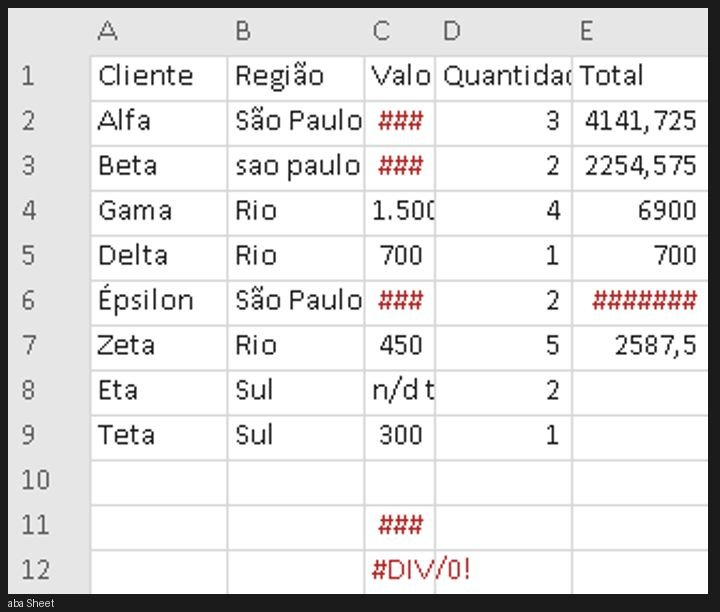
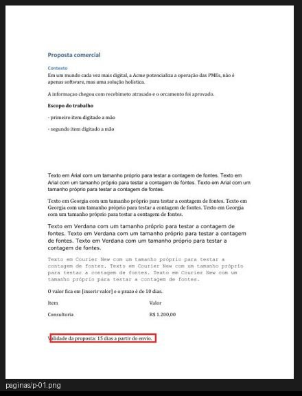
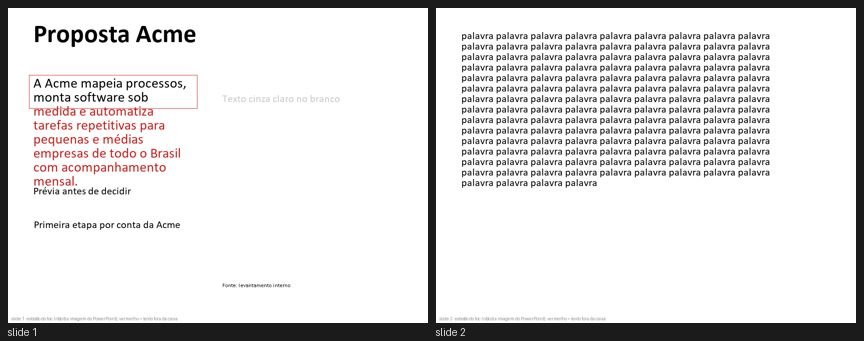

<h1 align="center">toc</h1>

<p align="center">
  <b>TOC</b> · Transtorno Obsessivo-Compulsivo &nbsp;|&nbsp; <b>OCD</b> · Obsessive-Compulsive Disorder<br>
  <sub>…para o seu agente de IA.</sub>
</p>

<p align="center">
  <a href="LICENSE"></a>
  &nbsp;
  &nbsp;
  &nbsp;<a href="README.md"></a>
</p>

<p align="center"><b>O agente diz "Pronto ✅". O toc diz: "a proposta ainda está escrito <code>[inserir valor]</code>".</b></p>

---

Sabe aquela sensação? Você tranca a porta, chega no carro e algo te puxa de volta: *será que tranquei mesmo?* Você confere. E confere de novo.

**O toc dá essa coceira para o Claude, apontada para a sua entrega.** Ele não consegue parar de trabalhar enquanto o total da planilha mostra `#DIV/0!`, o botão de pausa no celular está em cima do botão principal ou o PDF ainda diz "generated by python-docx". Diferente do de verdade, este tem botão de desligar e limite de rodadas.

> O nome brinca com o hábito de conferir e reconferir, não com quem convive com o TOC.

## Instalação

```bash
git clone https://github.com/luccameyer18-creator/claude-skill-toc && node claude-skill-toc/install.mjs
```

Ele copia a skill para `~/.claude/skills/toc`, põe o hook de Stop no `~/.claude/settings.json` (com backup) e avisa o que falta instalar. Abra uma sessão nova do Claude Code e peça:

```
modo toc: faz a proposta da Acme em Word, 2 páginas, com Contexto, Escopo e Investimento
```

ou só *"não para até ficar perfeito"*.

## Sem toc e com toc

| Sem toc | Com toc |
|---|---|
| "Pronto! Fiz a proposta, a planilha e a landing ✅" | `toc, rodada 1/8. Achei pendências:`<br>`[contrato C1] seções Contexto, Escopo, Investimento: falta Investimento`<br>`[bloqueia] "O valor fica em [inserir valor]"`<br>`[bloqueia] Planilha!C12 mostra #DIV/0!`<br>`[corrigir] =SOMA(C2:C8) para na linha 8, os dados vão até a 9`<br>`[corrigir] botão de pausa cobre "Ver como funciona" em 390px`<br>`[corrigir] "informaçao" → informação` |
| Você acha os erros junto com o cliente. | O Claude acha, conserta, e um revisor de fora confere antes de ele poder parar. |

<table>
  <tr>
    <td width="50%"><br><sub>Planilha: <code>####</code>, <code>#DIV/0!</code>, "São Paulo" e "sao paulo " na mesma coluna.</sub></td>
    <td width="50%"><br><sub>Diff entre rodadas: o vermelho é a única coisa que mudou. Pega o "corrigiu A e quebrou B".</sub></td>
  </tr>
  <tr>
    <td colspan="2"><br><sub>Slides: texto que não cabe na caixa (em vermelho), cinza no branco com contraste 1,67:1, slide de 130 palavras sem título.</sub></td>
  </tr>
</table>

## Por quê

A IA entrega coisa com cara de pronta que não está pronta. O erro é pequeno, e é justamente o que vira print:

- `[inserir valor]` esquecido numa proposta cuja própria tabela diz R$ 1.200,00
- total `=SOMA(C2:C8)` com dados até a linha 9
- planilha "gerada por script" sem valor salvo nas fórmulas: a prévia do e-mail mostra células vazias
- `autor: python-docx` nas propriedades, papel Carta em documento brasileiro
- texto cinza claro com contraste 1,67:1 no slide, rodapé de 9pt no projetor
- "Não é apenas um software, mas uma solução holística" (e mais quatro travessões)
- consertar o topo da página e quebrar o rodapé sem perceber

Todos esses foram pegos nos testes do próprio toc.

## Como funciona

1. **Contrato.** O Claude transforma o seu pedido em `.claude/toc/contrato.json`: o que você pediu e o que não pode ser mexido. Nada que você não pediu vira exigência.
2. **Conferência.** Scripts olham a coisa de verdade: um navegador rola a página no desktop, no tablet e no celular (inclusive com movimento reduzido); Word e Excel abrem cópias dos arquivos para renderizar e recalcular; o texto passa por ortografia e padrões de texto de IA.
3. **Olho de fora.** Um revisor (subagente) que não viu a entrega sendo feita lê as fotos e o texto e grava um veredito. Ele recebe uma ficha tipográfica com as fontes que o navegador ou o Word usaram de verdade, para não chutar fonte pela foto.
   Depois disso a reconferência é barata: o hook recorta um "antes | agora" de cada pendência, mais o que mudou fora delas, e um modelo pequeno (Haiku) só marca resolvido ou não. Revisão inteira de novo só quando precisa.
4. **A coceira.** Um hook de Stop não deixa o Claude terminar enquanto houver pendência no contrato, nos scripts ou no veredito. Cada rodada é comparada com a anterior: conserto que quebra outra coisa aparece em vermelho.
5. **Ninguém corrige a própria prova.** Quando o laço liga, o toc trava o que confere: arquivos de teste (`*.test.*`, `*.spec.*`, `tests/`, `test_*.py`…), cada item do contrato, a nota mínima e o comando de build. Se o Claude muda o teste para passar, tira uma exigência ou baixa a régua, o hook bloqueia e manda `toc restaurar` (volta os originais). Mudar exige o seu sim (`toc liberar <arquivo> --motivo "..."`), e toda liberação aparece para você no fim do laço.
6. **O botão de desligar.** 8 rodadas por padrão e, no fim, um relatório honesto do que ficou aberto. Nunca "ficou perfeito".
7. **Não sequestra a conversa.** O laço é do pedido que o ligou. Mandou mensagem nova, ele pausa sozinho (o Claude só retoma se for a mesma entrega). Seis horas parado, ele desliga.

**Duas versões, não uma espremida.** Em página web o toc confere desktop e celular como projetos separados: celular sem nenhuma regra `@media` que mude o layout, colunas de texto espremidas abaixo de 150px, texto corrido abaixo de 14px, título com o mesmo tamanho nas duas telas. E o revisor sempre julga se cada tela tem a sua composição.

## O que ele confere

<details>
<summary><b>Página web</b></summary>

Contraste medido na foto (funciona sobre vídeo e WebGL), texto cortado ou saindo da tela, texto por cima de texto, botão fixo cobrindo outro, quase alinhado (2 a 4px), palavra sozinha ou "a" pendurado no título, área de toque, foco invisível, imagem esticada ou quebrada, fonte que não carregou, erro de console e de rede, salto de layout.

Sinais de página gerada e acabamento, com ideias do [Impeccable](https://github.com/pbakaus/impeccable) e do [Taste Skill](https://github.com/Leonxlnx/taste-skill): cinza sobre cor, hierarquia de tipo achatada, tamanhos de letra demais, tudo centralizado, etiqueta miúda e 01/02 acima do título, easing elástico, faixa colorida na lateral, texto com gradiente, seleção de texto sem a cor da marca. Mais o teste do olhar apertado: onde o olho cai primeiro?
</details>

<details>
<summary><b>Word, PowerPoint, Excel, CSV, PDF, Markdown</b></summary>

- **docx:** título que pula nível, título falso (negrito em estilo Normal), lista digitada à mão, linha vazia como espaçamento, fontes demais, revisão e comentários esquecidos, papel Carta, idioma de revisão errado. Com o Word: página em branco, título sozinho no pé da página, "Erro! A origem da referência não foi encontrada".
- **pptx:** texto que não cabe na caixa (medido com a fonte real), texto por cima de texto, objeto fora do slide, título mudando de lugar entre slides, fonte abaixo de 12pt, slide com texto demais, contraste, imagem esticada. O PowerPoint nunca é aberto; o revisor recebe um esboço.
- **xlsx:** erro de fórmula (recalculado no Excel), fórmula sem valor salvo, referência quebrada, número guardado como texto, soma que pula linha, fórmula fora do padrão da coluna, número fixo na fórmula, coluna com `####`, categoria escrita de dois jeitos.
- **csv / pdf / md:** codificação, linhas com colunas a mais, página em branco, link quebrado, bloco de código sem fechar.
</details>

<details>
<summary><b>Texto, em tudo</b></summary>

Erro bobo (texto de modelo esquecido, palavra repetida, vírgula colada, formatos de número e data misturados, nome escrito de dois jeitos), ortografia pelo dicionário do próprio Word e padrões de texto de IA em português e inglês: "não é só X, mas Y", "vale ressaltar", "estudos mostram" sem fonte, fecho com "em suma", mania de travessão, botão "Saiba mais". Ele nomeia o padrão e cita o trecho. Nunca dá nota de "cara de IA".
</details>

## Requisitos

- Node 18+
- Página web: Playwright no projeto (`npm i -D playwright`) e Chrome
- Documentos: Python 3 com `pip install python-docx python-pptx openpyxl pymupdf pillow`
- Opcional, Windows com Office: `pip install pywin32` para corretor do Word, páginas renderizadas e cálculo no Excel. Sem isso, essas partes aparecem como `nao-conferido` no relatório, em vez de passarem caladas.

## Gastando menos token

- Os revisores do toc são agentes enxutos (`toc-revisor`, `toc-reconferente`) que só leem e gravam arquivo. Subagente comum herda todas as ferramentas e MCPs instalados, e era daí que vinha a maior parte dos ~65–70 mil tokens de cada chamada. Medido na mesma reconferência: 73 mil tokens antes, 16 mil com o agente enxuto.
- A reconferência manda ao Haiku só recortes "antes | agora" das pendências, não a entrega inteira para um modelo maior.
- Combina com [caveman](https://github.com/JuliusBrussee/caveman) (respostas mais curtas), [rtk](https://github.com/rtk-ai/rtk) (saída de comando menor) e [context-mode](https://github.com/mksglu/context-mode) (tira a saída bruta das ferramentas do contexto).

## Limites, sem enfeite

- Script mede. Gosto é do revisor e a palavra final é sua. "O laço fechou" quer dizer "o combinado foi conferido", não "ficou perfeito".
- Texto que não cabe no slide é estimativa; o PowerPoint nunca é automatizado.
- Página atrás de login ou senha de loja: rode `toc login URL` uma vez. Abre o Chrome, **você** entra e fecha a janela, e as próximas conferências reaproveitam a sessão (`.claude/toc/sessao.json`, fora do git). O Claude nunca digita sua senha. Se mesmo assim a conferência cair numa tela de login, ela para e avisa, em vez de dar nota para a página errada.
- A lista de padrões de texto de IA em português é adaptação nossa e pode errar. Use `dispensas` no contrato; toda dispensa aparece no relatório final.
- Uma rodada de página leva de 1 a 3 minutos; de documento, de 10 a 30 segundos.

## Comandos

```bash
node ~/.claude/skills/toc/scripts/toc.mjs iniciar | conferir | esperar | login URL | status | pausar | retomar | parar
python -I ~/.claude/skills/toc/scripts/doc.py extrair ARQUIVO PASTA     # só o leitor de documentos
python -I ~/.claude/skills/toc/scripts/doc.py recalcular planilha.xlsx  # grava o valor das fórmulas
node ~/.claude/skills/toc/scripts/slop.mjs rascunho.md                  # só o verificador de texto
```

Formato do contrato: [`toc/referencias/contrato.md`](toc/referencias/contrato.md). Amostras com erro plantado para testar: [`exemplos/`](exemplos/).

## Créditos

Ideias reescritas (nenhum arquivo copiado) do [Ralph Loop](https://github.com/anthropics/claude-plugins-official) (Anthropic), visual-verdict ([oh-my-claudecode](https://github.com/Yeachan-Heo/oh-my-claudecode)), design-review ([OneRedOak](https://github.com/OneRedOak/claude-code-workflows), [jezweb](https://github.com/jezweb/claude-skills)), [design-review-loop](https://github.com/propiter/landing-craft), [Taste Skill](https://github.com/Leonxlnx/taste-skill), [Impeccable](https://github.com/pbakaus/impeccable), [pixelmatch](https://github.com/mapbox/pixelmatch), [odiff](https://github.com/dmtrKovalenko/odiff) e da skill no-ai-slop. Detalhes em [`toc/CREDITOS.md`](toc/CREDITOS.md).

## Licença

MIT
